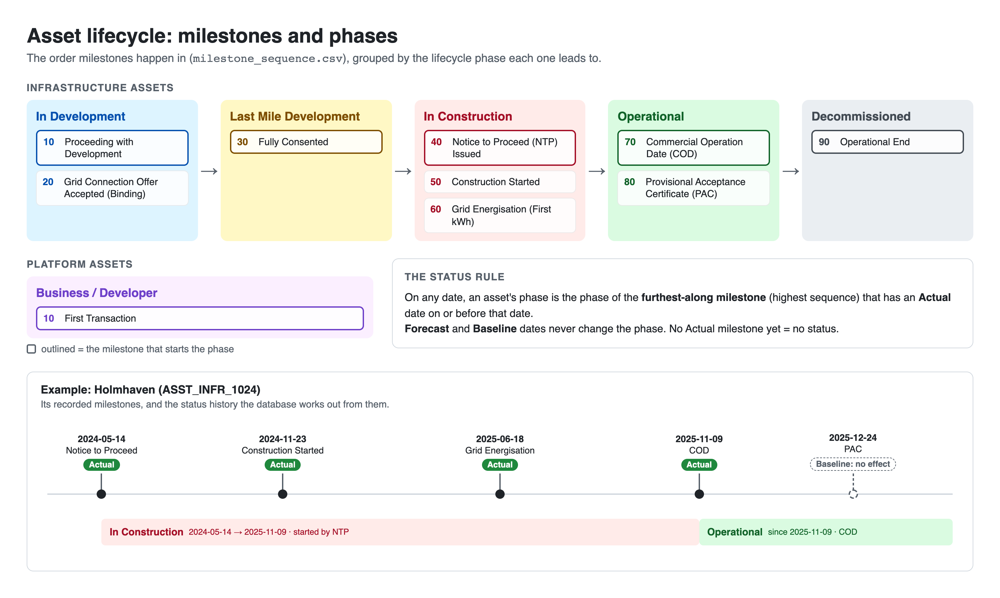

# Asset Lifecycle Manager – Junior Developer Tech Test

Welcome! In this test you'll turn a messy spreadsheet export into a well-designed
PostgreSQL database and build a small app to manage it.

You are **not** expected to know everything listed here already. Some of it
(triggers, SQL functions, FastAPI) may be new to you. Each step has **hints**
pointing you at what to research. Researching, experimenting and explaining what
you learned is a big part of what we're assessing.

**Time guide: about 3 hours. Please don't spend more than that.**
Steps 1–4 are the core of the test; the optional extras are there if you have
time. If you run out of time, stop and write down what you would do next. An
unfinished submission with clear reasoning is better than a rushed, complete one.

**Using AI tools:** we encourage it, just as you would use them at work. But you
must understand and be able to explain everything you submit, including why you
made each decision. Record your decisions in `design_decisions.md` (see
[What to submit](#what-to-submit)). We'll talk through them with you afterwards.

---

## The goal

An investment fund owns renewable energy assets: solar farms, wind farms,
batteries and so on. Each asset moves through a **lifecycle**, from development
through construction to operation, marked by **milestones** such as "Fully
Consented" or "Commercial Operation Date". Each asset also has **people
responsible for it**, such as its Finance Lead or Asset Management Lead.

Today all of this lives in one spreadsheet export, `data/asset_milestones.csv`.
Everything is repeated on every row, nothing stops inconsistent data getting in,
and nobody can easily see an asset's current status or who owns it.

Your job is to build a simple **asset lifecycle manager**:

- a **PostgreSQL database** that stores assets, their milestones and the people
  responsible for them, and **works out each asset's lifecycle status from its
  milestones automatically**;
- a **lightweight app** where someone in the team can record milestones, see the
  status update, and assign people to assets.

It should make it easy to answer questions like:

- What phase is each asset in today, and since when? What phase was it in on a
  given date?
- Which milestones has an asset reached, and which are still forecast?
- Who is responsible for each asset, and which assets have nobody, or too many
  people, in a key role?

And it should make it hard to get the data wrong: for example, recording a
milestone as having actually happened on a date in the future.

---

## Understanding the data

All names, people, IDs, dates and figures are anonymised. There are two files.

### The pieces and how they relate

- **Fund**: the investment fund. There is only one in this extract.
- **Portfolio**: a fund groups its investments into portfolios. Each portfolio
  belongs to one fund and holds one or more assets.
- **Asset**: a single investment. It is one of two types:
  - **Infrastructure**: a physical asset, such as a wind farm. It has a
    **technology** (e.g. Onshore wind), which belongs to a broader
    **technology group** (e.g. Clean Power Generation). It is in a **country**
    and has a **capacity** in megawatts (MW).
  - **Platform**: a business, such as a developer that builds many projects.
    Platforms have no technology, country or capacity of their own.
- **Company**: each asset is legally held by a project company (its "registered
  name"). One company can hold more than one asset.
- **Milestones**: the key events in an asset's life (see below). An asset has
  many milestones.
- **Experts**: the people responsible for an asset, each in one or more **roles**
  (e.g. "Finance Lead"). One person usually works on many assets.

### Milestones and lifecycle status

`data/milestone_sequence.csv` is the **reference list of milestones**. It gives
the order they happen in, and the **lifecycle phase** an asset is in once each
one has actually happened:

| Sequence | Milestone | Asset type | Once it has happened, the asset is… |
|---|---|---|---|
| 10 | Proceeding with Development | Infrastructure | In Development |
| 20 | Grid Connection Offer Accepted (Binding) | Infrastructure | In Development |
| 30 | Fully Consented | Infrastructure | Last Mile Development |
| 40 | Notice to Proceed (NTP – or equivalent) Issued | Infrastructure | In Construction |
| 50 | Construction Started | Infrastructure | In Construction |
| 60 | Grid Energisation Date (First kWh) | Infrastructure | In Construction |
| 70 | Commercial Operation Date (COD) | Infrastructure | Operational |
| 80 | Provisional Acceptance Certificate (PAC) | Infrastructure | Operational |
| 90 | Operational End | Infrastructure | Decommissioned |
| 10 | First Transaction | Platform | Business / Developer |

Each milestone recorded for an asset has a **type**:
- **Actual**: it happened on that date.
- **Forecast**: it's expected on that date.
- **Baseline**: the date originally planned.

**The status rule.** On any date, an asset's lifecycle phase is the phase of the
**furthest-along milestone (highest sequence) that has an Actual date on or
before that date**. Forecast and Baseline dates never change the status. If an
asset hasn't actually reached any milestone yet, it has no status.

For example, an asset with Notice to Proceed (Actual, 2024-05-14) and COD
(Actual, 2025-11-09) was In Construction from 2024-05-14, and has been
Operational since 2025-11-09. If its COD were only a Forecast, it would still be
In Construction.



### Experts and roles

The `experts` column lists the people responsible for each asset and their roles,
identified by name and email. As part of the fund's push to give every piece of
data a clear owner, **every asset should have exactly one person in each of
these key roles**:

- Asset Mgmt Lead
- Finance Lead
- Valuations Lead

The current data doesn't meet this yet. Your app is how the team will fix it.

### How the rows work

`asset_milestones.csv` has **one row per mention of a milestone for an asset**.
Everything about the asset (its name, portfolio, technology, experts…) is
repeated on each of its rows. Separating "what an asset is", "what happened to
it" and "who is responsible for it" is a big part of this test.

See `data/DATA_DICTIONARY.md` for every column and a JSON example.

### Known data issues

Like most real data, this export isn't perfectly clean. These are the issues we
know about. **How you handle each one is up to you**: you could fix it, reject
it, keep it and flag it, or decide it doesn't matter. Explain your choices in
`design_decisions.md`. If you find others, add them.

1. **Missing values are written as the text `null`**, not left empty. This
   affects the technology, technology group, country and capacity columns for
   Platform assets.
2. **Exact duplicate rows.** The export repeats some milestones: 52 rows, but
   only 31 distinct asset milestones.
3. **Dates are timestamps**, e.g. `2011-11-27T00:00:00.000Z`, even though only
   the date matters.
4. **An ID that doesn't match the reference list.** The export uses the name
   `First Transaction` as that milestone's ID; the reference list calls it
   `LIFE_MILE_1000`.
5. **An Infrastructure asset with 0 MW capacity**: `ASST_INFR_1021`.
6. **Forecasts out of order.** `ASST_INFR_1033`'s COD is forecast for 2032, two
   years *before* its grid connection offer (forecast for 2034).
   `ASST_INFR_1035` has both forecast on the same day.
7. **A forecast date that has passed with nothing recorded.** `ASST_INFR_1073`'s
   COD was forecast for 2026-07-26, but there is no Actual COD.
8. **Incomplete histories.** Most operational assets only have their COD
   recorded, with no earlier milestones, and `ASST_INFR_1061`'s history starts
   at Fully Consented.
9. **A milestone with only a Baseline date.** `ASST_INFR_1024`'s PAC has a
   Baseline but no Actual or Forecast.
10. **Nobody in a key role.** `ASST_INFR_1001` and `ASST_INFR_1002` have no
    Asset Mgmt Lead; `ASST_INFR_1061` has no Finance Lead.
11. **Several people in one key role.** `ASST_INFR_1024` has four Asset Mgmt
    Leads; `ASST_INFR_1007` has two Valuations Leads.
12. **Two assets share a project company**: `ASST_INFR_1033` and `ASST_INFR_1035`.

---

## What we want you to build

Do as much as you can, in order. Each step lists **what "done" looks like**, plus
hints on what to research.

**About the checkpoints:** the expected results assume you keep the source data
as it is (apart from removing duplicates). If one of your data-issue decisions
changes a result, that's fine. Say which one and why in `design_decisions.md`.

### 1. Set up and load

- Run PostgreSQL locally: `docker compose up -d` starts Postgres 16 with
  user/password `techtest` and database `assets`. (Or use your own install.)
  - If port 5432 is already in use, copy `.env.example` to `.env` and change
    `POSTGRES_PORT` (and the port in `DATABASE_URL`, which your app will use).
  - Connect with `docker compose exec postgres psql -U techtest -d assets`, or any
    database client you like.
  - Inside the container the CSV files are in `/data/`.
  - `docker compose down -v` deletes the database so you can start again.
- Load both CSVs, unchanged, into tables called `raw_asset_milestones` and
  `raw_milestone_sequence`.

**Done when:** `raw_asset_milestones` has **52 rows** and `raw_milestone_sequence`
has **10 rows**.

> **Hints:** look up Postgres's `COPY` command and psql's `\copy`, and how they
> differ in where they read the file from. Making every raw column `text` means
> nothing gets rejected on load; you can convert types in the next step.

### 2. Design the schema

Design a normalised schema and write the SQL to create and populate it from the
raw tables. Use appropriate data types, primary keys, foreign keys and
constraints (e.g. `NOT NULL`, `CHECK`, `UNIQUE`).

**Done when** your schema has a table for each of these, populated from the raw
tables:

| Entity | Notes |
|---|---|
| Fund | |
| Portfolio | belongs to a fund |
| Technology and technology group | a technology belongs to a group |
| Country | |
| Company | the project company that holds an asset |
| Asset | name, type, portfolio, company, technology, country, capacity |
| Lifecycle phase | |
| Milestone (reference list) | from `milestone_sequence.csv`: sequence, asset type, the phase it leads to |
| Asset milestone | the milestones recorded for each asset: which one, its type and date |
| Person and role | unpacked from `experts` |
| Asset expert | who holds which role on which asset |
| Asset status history | one row per period an asset spent in a phase – see step 3 |

Checkpoints – once populated you should have:

| | Count |
|---|---|
| Assets | 17 (15 Infrastructure, 2 Platform) |
| Portfolios | 13 |
| Funds | 1 |
| Technologies | 6 (in 3 groups) |
| Countries | 7 |
| Companies | 16 |
| Lifecycle phases | 6 |
| Milestones (reference list) | 10 |
| Asset milestones | 31 (21 of them Actual) |
| People | 37 |
| Roles | 8 |
| Asset expert assignments (asset + person + role) | 94 |

> **Hints:**
> - Research "database normalisation" (first, second and third normal form) and
>   "many-to-many relationships" / "junction tables".
> - `INSERT INTO ... SELECT DISTINCT ...` fills a table from a raw table, and
>   removes duplicates as it goes.
> - `NULLIF(value, 'null')` turns the text `null` into a real `NULL`.
> - For the `experts` JSON, look up `jsonb_array_elements`,
>   `jsonb_array_elements_text` and the `->>` operator.
> - `GENERATED ALWAYS AS IDENTITY` gives a table an auto-numbered primary key.

### 3. Status from milestones

Make the database work out each asset's lifecycle status from its milestones,
using [the status rule](#milestones-and-lifecycle-status). Store the result in
an **asset status history** table: one row per period, with a start date, an end
date (or none, if it's the current phase) and the phase.

**Done when** you have:

- **A trigger** on your asset milestone table so that whenever a milestone is
  **added, changed or deleted**, that asset's status history is updated
  automatically.
- **A rule that rejects an Actual milestone dated in the future**, with a clear
  error. A trigger is one way to do this.
- **A function** `asset_status_as_of(asset_id, as_of_date)` that returns the
  asset's phase on that date (and since when), or nothing if it had no status
  then.

Checkpoints:

| Call | Expected |
|---|---|
| `asset_status_as_of('ASST_INFR_1024', '2025-11-08')` | In Construction, since 2024-05-14 |
| `asset_status_as_of('ASST_INFR_1024', '2025-11-09')` | Operational, since 2025-11-09 |
| `asset_status_as_of('ASST_INFR_1021', '2025-10-14')` | In Development, since 2024-06-26 |
| `asset_status_as_of('ASST_INFR_1073', '2026-10-01')` | In Construction (its COD was only forecast) |
| `asset_status_as_of('ASST_INFR_1061', '2025-12-09')` | nothing |
| `asset_status_as_of('ASST_PLAT_1002', '2025-01-01')` | Business / Developer, since 2024-06-28 |

Show your trigger working in `design_decisions.md` or a SQL file. For example,
record an Actual COD of 2026-08-13 for `ASST_INFR_1073` and show its history
afterwards (In Construction until 2026-08-13, then Operational). Then delete it
and show the history go back.

> **Hints:**
> - **Triggers:** look up `CREATE TRIGGER`, trigger functions written in
>   PL/pgSQL, `BEFORE` vs `AFTER` triggers, the `NEW` and `OLD` records,
>   `TG_OP`, and `RAISE EXCEPTION`.
> - **Keep it simple:** when an asset's milestones change, it's fine to delete
>   and rebuild that asset's whole status history, rather than working out
>   exactly which periods to edit. Think about why that's easier to get right.
> - **Building the history:** for each date an Actual milestone happened, find
>   the furthest milestone reached by then. Look up window functions such as
>   `lag()` and `lead()` to find where the phase changes and where each period ends.
> - **Load order:** decide whether your trigger exists before you load the
>   existing milestones. If it does, the load builds the history for you.
> - **Functions:** look up `CREATE FUNCTION` with `LANGUAGE sql` and
>   `RETURNS TABLE (...)`.
> - **Going further:** look up range types (`daterange`), exclusion constraints
>   (`EXCLUDE USING gist`) and the `btree_gist` extension, a way to make the
>   database itself refuse overlapping periods.

### 4. The app

Build a lightweight web app on top of your database:

- **Backend: FastAPI** (Python 3.11 or later). Use any database library you like,
  e.g. psycopg, SQLAlchemy or asyncpg.
- **Frontend: your choice.** A plain HTML page with JavaScript, server-rendered
  templates, React, Vue… whatever you're comfortable with. Keep it simple: we're
  assessing whether it works and how it talks to the API, not how it looks.

**Done when** someone can, through the frontend:

1. **See a list of assets** with their current lifecycle phase and since when.
2. **Open an asset** and see its details, its milestones (Actual and planned),
   its status history and the people responsible for it.
3. **Record a milestone** for an asset (chosen from the reference list, with a
   type and a date), and see the status update.
4. **Correct or delete a milestone**, and see the status update.
5. **Assign a person to an asset in a role**, including someone not yet in the
   database (name and email), and **remove an assignment**.
6. **See a clear error message** when something is rejected, e.g. an Actual
   milestone in the future, or assigning the same person to the same role twice.

The API behind it should:

- return **404** for an asset (or milestone, or assignment) that doesn't exist;
- return **422** for invalid input (FastAPI does this for you if you use typed
  parameters and Pydantic models);
- return **409** with the reason when the database rejects a change (e.g. your
  future-date rule, or a duplicate), **not** a 500 error;
- read its database connection details from configuration (e.g. an environment
  variable), not hard-code them.

You choose the routes. As a starting point, something like this would work:

| Method | Route | Purpose |
|---|---|---|
| GET | `/assets` | List assets with their current phase |
| GET | `/assets/{asset_id}` | One asset's details, milestones, status history and experts |
| POST | `/assets/{asset_id}/milestones` | Record a milestone |
| PATCH / DELETE | `/milestones/{id}` | Correct or delete a milestone |
| POST | `/assets/{asset_id}/experts` | Assign a person to a role |
| DELETE | `/experts/{id}` | Remove an assignment |

> **Hints:**
> - The official FastAPI tutorial covers everything you need: path and query
>   parameters, request bodies with Pydantic models, and `HTTPException`. FastAPI
>   also gives you interactive API docs at `/docs` for free, which is handy for
>   testing before the frontend exists.
> - Use **parameterised queries**, never string formatting, to put values into
>   SQL. Look up "SQL injection" if you're not sure why.
> - Look up how your database library reports Postgres errors and their **error
>   codes** (SQLSTATE), so you can turn a rejected change into a 409.
> - If your frontend runs on a different port from the API, look up **CORS** and
>   FastAPI's `CORSMiddleware`. Serving the page from FastAPI itself
>   (`StaticFiles`) avoids that.
> - Think about where each rule lives. Should the API check that a date isn't in
>   the future, the database, or both? There's no single right answer; explain
>   your choice.

---

## Optional extras (only if you have time)

In rough order of value:

**Views.** Create these views:
- `asset_current_status`: one row per asset with its phase today
  (`current_date`) and since when, plus its name, technology, country and
  portfolio. Your app's asset list could use it.
- `asset_responsibility_gaps`: every asset and key role (Asset Mgmt Lead,
  Finance Lead, Valuations Lead) that doesn't have exactly one person. On the
  source data this gives **5 rows**.
- `capacity_by_phase`: total capacity (MW) of Infrastructure assets by
  lifecycle phase and technology, as of today. As a check: on `2026-01-01`,
  Operational assets total 176.553 MW of Ground mount solar, 650.643 MW of
  Offshore wind, 231.588 MW of Onshore wind and 2.019 MW of Rooftop solar.

> **Hint:** a view can't take a parameter, but it can select from a function that
> does. That's one way to check a "today" view against a fixed date.

**Indexes.** Add the indexes you think this database needs, and explain in
`design_decisions.md` which queries each one helps. With this little data
Postgres will often ignore an index and scan the whole table, and that's expected.

> **Hint:** find out which indexes Postgres creates for you automatically, and
> look up `EXPLAIN` and the `enable_seqscan` setting.

**Repeatable build.** A single script or command that builds the whole database
from scratch.

**Tests.** Automated tests, e.g. pytest tests for your API, or SQL checks for
the checkpoints above.

---

## Folder structure

```
data/                 the source CSVs and data dictionary (don't modify the CSVs)
docs/                 the milestone lineage diagram
sql/                  your SQL: tables, load, functions, triggers (and any views, indexes)
app/                  your FastAPI backend and your frontend
design_decisions.md   how to build and run it, your decisions and reasoning, data issues, what you'd do next
```

Use whatever file names and sub-structure you like inside `sql/` and `app/`
(e.g. `app/backend` and `app/frontend` if your frontend has its own build).

## What to submit

Send us a link to a **GitHub repository** that we can clone and run locally.

- **Make it public**, or keep it private and give us access (we'll tell you which
  GitHub account to add).
- **Start with the files as we gave them to you** in your first commit, so your
  own work is easy to see.
- **Use branches.** Do your work on a branch, or one branch per step, and merge
  into `main` (pull requests are welcome; merging your own is fine).
- **Make small, logical commits** with clear messages, so we can follow how your
  solution developed. Please don't squash everything into a single commit.
- **`main` must work from a fresh clone.** We'll follow the instructions in your
  `design_decisions.md` exactly, on a machine with Docker and Python, to build the
  database and start the app. Include any other tools needed (e.g. Node.js) and
  how to install dependencies, e.g. a `requirements.txt`. Test the instructions
  yourself in a fresh clone before sending.
- **Fill in `design_decisions.md`**: how to build and run everything, the
  decisions you made and why, how you handled each data issue, how you used AI
  tools, and what you'd do with more time.

## What we look for

- Sensible data modelling and naming
- Good use of types, keys and constraints
- Correct, readable SQL, and a trigger that keeps the status right
- A small, working app that updates the data safely and handles errors properly
- Clear explanations of your decisions and trade-offs, and being able to talk
  through them, including any code written with AI help
- A clean, traceable Git history

Be ready to talk through your work.
